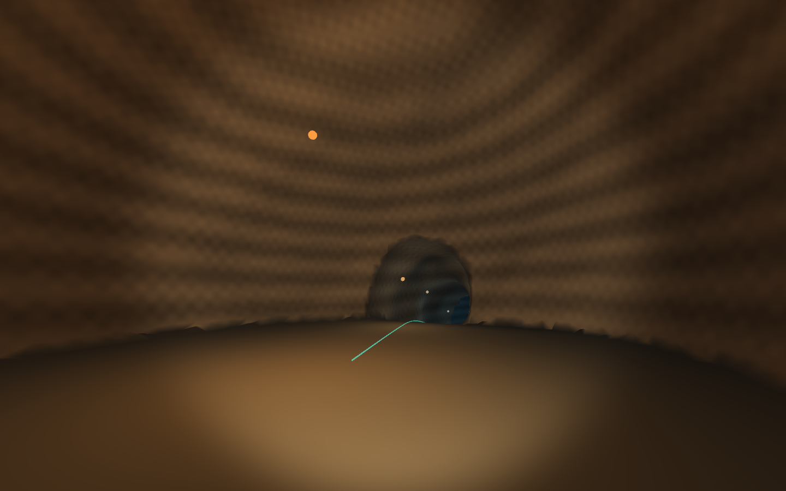

# They Yearn for Procedural Mines

A seeded cavern-generation toolkit in C#, with a Unity integration layer.

The first prototype generates two cavern chambers at different elevations, joined by a curved, sloping passage. A protected walking route runs through a 3D cave volume; marching tetrahedra extracts an inward-facing mesh with collision.

**Early prototype:** bounded generation, basic rock shading and lighting, and an exploration sample. Mining, destruction, flora/fauna, streaming, and persistent edits are future work.



## Try it

1. Install **Unity 6000.4.0f1** through Unity Hub and activate your license.
2. Clone the **whole repository**; the sample references the packages in `src/`.
3. In Hub, choose **Add → Add project from disk**, selecting **`samples/TwoChambers`**.
4. Open **`Assets/Scenes/TwoChambers.unity`** (also available under **Procedural Mines → Open Two Chambers**).
5. Press **Play** and click outside the settings panel to capture the mouse.

| Control | Action |
| --- | --- |
| WASD / arrow keys | Walk |
| Mouse | Look |
| Left Shift | Walk faster |
| Escape | Release mouse for settings |
| R / Return to entrance | Reset position |
| Generate | Apply seed, depth, and rock variation |

The Inspector exposes resolution and player dimensions. Changes apply on regeneration. Invalid settings display an error and preserve the active cave. Inspector previews are temporary.

The sample uses the **Built-in Render Pipeline** and legacy Input Manager. No Asset Store art or external noise library is required.

## Defaults and diagnostics

Chambers are 46 m apart with a 6 m descent. Grid spacing is 0.8 m. The player capsule has radius 0.4 m, height 1.8 m, a 30-degree slope limit, and 0.25 m step allowance. The protected route includes 0.25 m clearance plus two cells of meshing margin.

The default seed `1337` produces approximately 25,000 vertices and 50,000 triangles. The overlay reports geometry counts, core generation time, and scene/collision setup time. Generation is synchronous and may pause the editor briefly.

## Repository

| Path | Purpose |
| --- | --- |
| `src/Core/` | Unity-free .NET Standard 2.1 library and local Unity package |
| `src/Unity/` | Mesh/collision adapter, controller, shader, and editor tools |
| `samples/TwoChambers/` | Unity project and Play Mode integration tests |
| `tests/CoreChecks/` | Dependency-free .NET 10 executable checks |
| `docs/` | Architecture, milestone, and verification |

## Checks

With .NET 10 SDK:

```sh
dotnet run --project tests/CoreChecks -c Release
```

Checks cover repeatability, invalid settings, closed surfaces, triangle integrity, inward normals, and route clearance/slope across six seeds. GitHub Actions runs them on pushes and pull requests.

For Unity collision/traversal tests, open **Window → General → Test Runner → PlayMode → Run All**. See [verification](docs/verification.md) for coverage, commands, and results.

The sample also provides **Procedural Mines → Run sample verification**, which saves XML results under artifacts. **Build Windows sample** creates a local development player. Turn off **Gizmos** in the Game view to hide Unity's editor light icons and wireframes while exploring.

See [architecture](docs/architecture.md) and [milestone scope](docs/first-milestone.md). Repeatability is scoped to the same settings, algorithm version, and supported runtime; seeds are not stable world saves across future algorithm changes.

## License

[MIT](LICENSE). Unity and its official packages retain their own licenses.
